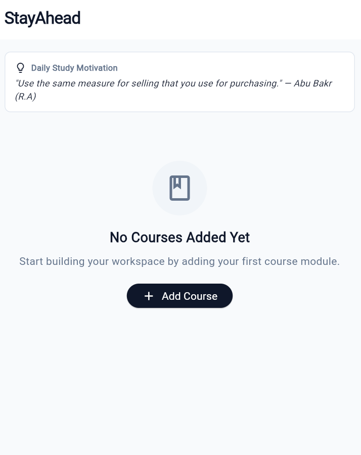
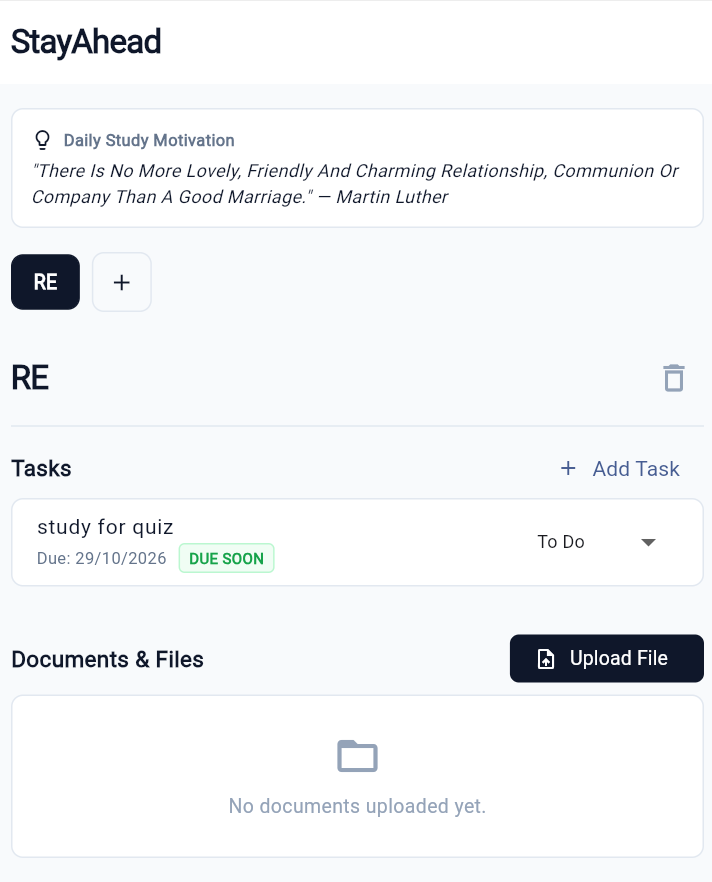
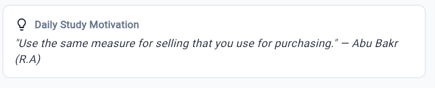
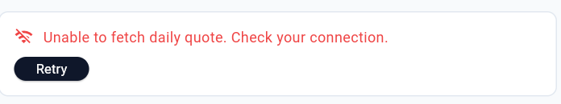

# StayAhead

StayAhead is a workspace app for students to organize course modules, track tasks with due dates, and upload study documents. My data is now saved on the phone with `shared_preferences`, so nothing is lost when the app closes, and it shows motivational quotes and academic study facts from the DummyJSON Quotes & UselessFacts API.

## Screenshots

---

## Features & UI Mapping

- **Two Screens**: `HomeScreen` for dashboard/task management and `AssignmentDetailsScreen` for viewing/editing notes.
- **`add` Command**: Triggered via `NEW TASK` FAB to open a modal dialog with DatePicker validation.
- **`complete` Command**: Toggled via item checkboxes or details controls. Re-completing an already completed task displays an error message.
- **`list` Command**: Rendered dynamically via `ListView.builder`.
- **`pending` Command**: Handled using a segmented `ToggleButtons` filter (`ALL`, `PENDING`, `COMPLETED`).
- **`report` Command**: Rendered as live metric cards showing `TOTAL`, `PENDING`, and `DONE`.
- **Search & Filter**: Real-time text search and filter segments.
- **Delete Confirmation & Undo**: Dialog verification on deletion with a SnackBar `Undo` action.

---

## Lab 12 Scenario Test Routine

1. Tap `NEW TASK` $\rightarrow$ Add `Database` with due date `2026-10-20`.
2. Tap `NEW TASK` $\rightarrow$ Add `Mobile` with due date `2026-10-18`.
3. Tap `NEW TASK` $\rightarrow$ Add `Networking` with due date `2026-10-25`.
4. Tap `Mobile` checkbox to complete it.
5. Tap `Mobile` checkbox again $\rightarrow$ Displays error: `Error: Mobile is already completed.`.
6. Tap `PENDING` filter chip $\rightarrow$ Shows `Database` and `Networking`.
7. View report cards at top $\rightarrow$ `TOTAL: 3`, `PENDING: 2`, `DONE: 1`.

---

## Think

### 1. Which Lab 12 command was the hardest to turn into a screen, and why?
The `complete` command was the most challenging to transition to UI because in the CLI version, completion was requested by typing a subject string (`complete:Mobile`). On a screen, completing an item can happen via a checkbox, a button inside a list tile, or from a details screen. Handling edge-case validations (such as attempting to re-complete a finished task) while keeping the UI checkbox state synchronized across filters required careful state management inside `setState()`.

### 2. What did you change in your Lab 12 logic once it had a screen, and why?
In the CLI logic, output was printed to stdout sequentially using `print()`. When transitioning to a graphical interface, text output was replaced with persistent reactive state rendering. Commands were refactored from `if/else if` string parsers into direct event handlers attached to widgets (`onPressed`, `onChanged`, `onTap`), and feedback messages were converted from terminal logs into `SnackBar` popups.
# stay_ahead
