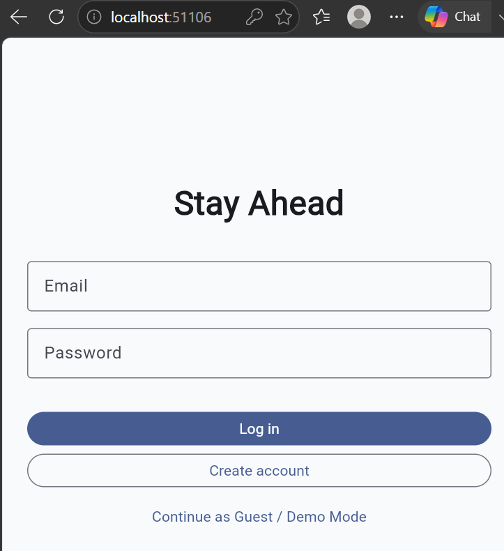
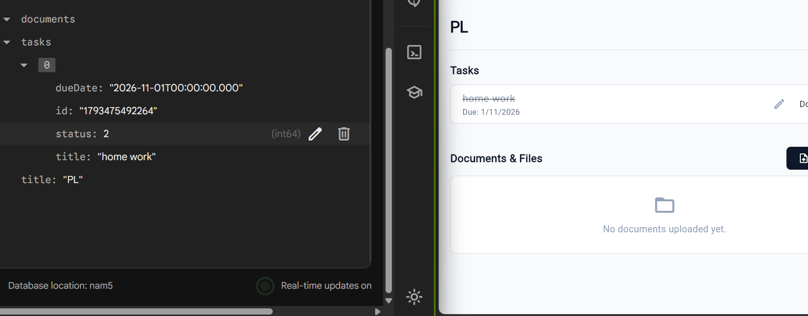
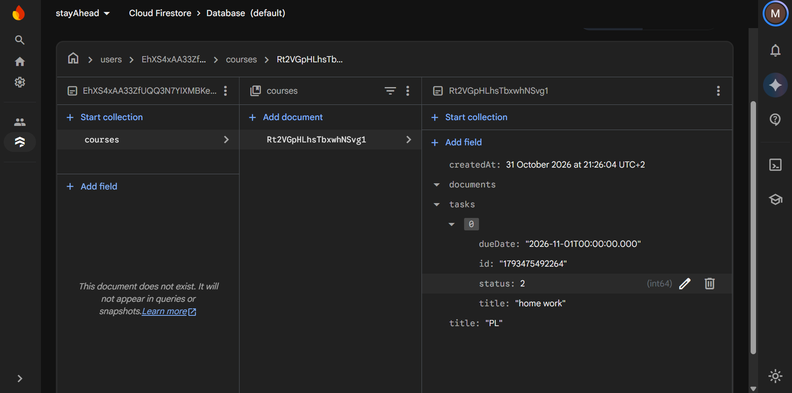
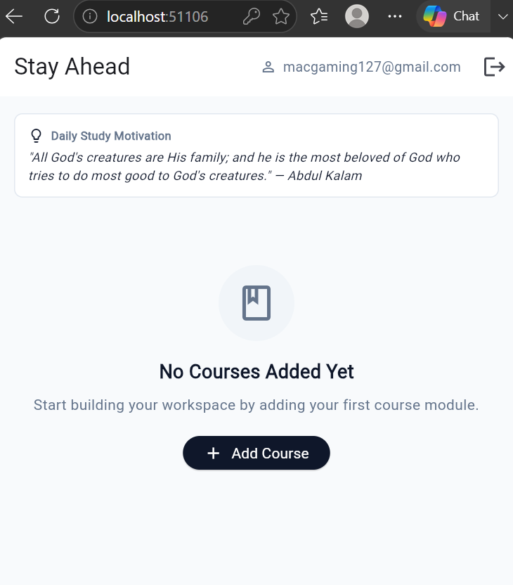

# StayAhead — Firebase Cloud Integration (Session 6)

StayAhead is a modern workspace app for students to organize course modules, track tasks with due dates, upload study documents, and receive daily motivation quotes. 

The application is fully backed by **Firebase Cloud services**:
- **Firebase Authentication**: Email and password user registration, login, session persistence, and secure logout.
- **Cloud Firestore**: Real-time cloud database syncing user-specific courses, tasks, and documents live across screens and devices.
- **Firestore Security Rules**: User-isolated data security ensuring each user can only read and write their own documents.

---

## 📷 Screenshots

### 1. Authentication (`LoginScreen`)

*Email and password authentication screen supporting sign-up, sign-in, input validation, and user feedback.*

### 2. Live Firestore Workspace (`DashboardScreen`)

*Real-time reactive dashboard powered by `StreamBuilder` listening to Firestore snapshots (`users/{userId}/courses`).*

### 3. Firebase Console

*Firebase Console displaying registered authentication users and user-scoped Firestore documents.*

### 4. Security Rules Enforcement

*Cloud Firestore security rules validating authentication status and preventing unauthorized access.*

---

## 🚀 Key Features & Architecture

- **`AuthGate` Navigation**: Uses `FirebaseAuth.instance.authStateChanges()` to automatically route users to either `LoginScreen` or `DashboardScreen`.
- **Real-Time Data Streaming**: `StreamBuilder<List<CourseModule>>` listens to `userCoursesStream()`, immediately reflecting any cloud database updates.
- **User-Isolated Storage**: All data is saved under `/users/{userId}/courses/{courseId}` in Cloud Firestore.
- **Daily Motivation API**: Integrates external quotes and facts APIs with offline error handling and retry mechanisms.

---

## 🔒 Cloud Firestore Security Rules

```javascript
rules_version = '2';
service cloud.firestore {
  match /databases/{database}/documents {
    // Each user can only read and write their own data
    match /users/{userId}/{document=**} {
      allow read, write: if request.auth != null && request.auth.uid == userId;
    }
  }
}
```

---

## 🧪 Verification & Test Steps

1. Launch application $\rightarrow$ Presented with `LoginScreen`.
2. Enter email and password $\rightarrow$ Tap **Create Account** / **Log In**.
3. Upon authentication, `AuthGate` streams user state and opens `DashboardScreen`.
4. Add a new course module or task $\rightarrow$ Data instantly persists to Cloud Firestore under `/users/{userId}/courses`.
5. Tap the **Logout** icon in the AppBar $\rightarrow$ Session ends and returns to `LoginScreen`.
